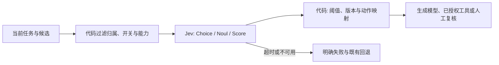

# OpenHorn 中 Jev 的可用位置与实测结论

> 调研阶段快照：以下“尚未接入”“未写配置”描述的是初始盘点阶段。用户随后授权了[首批实现](2026-11-09_jev-integration-results.md)及[提交收尾](2026-11-09_jev-ship-validation.md)；24项建议并未全部实施。

建议把 Jev 作为独立的“语义判断层”，先用于评论分类、候选内容筛选、检索重排和技能建议。全项目盘点得到 **24 个有价值的接入候选**，其中有直接替换点，也有需要新增产品能力的增强点；它们都尚未接入生产。

本轮按用户选择只做完整盘点和少量实测。使用用户提供的 OpenRouter 凭据，所有请求内容都是本报告附带的合成案例，没有发送真实会话、项目文件、评论数据集、配置密钥或工具执行日志。凭据仅保存在临时进程内存，实测后已清除，没有写入仓库或配置。

## 已验证的接入方式

- **请求地址**：`POST https://openrouter.ai/api/v1/systemone`。
- **请求模型**：`typesafe/jev-1.14`；21 次成功回执均解析到 **`typesafe/jev-1.14-20261014`**，provider 为 TypeSafe。
- **返回**：`answers` 中的 Choice、Noul、Score，包含相应概率；还有 OpenRouter 的 `usage.cost`。本轮没有测试 Box。
- OpenRouter 还提供 `POST /api/alpha/decisions`，本轮未调用，不混用两套响应约定。
- `/api/v1/models` 默认公开列表中找到的 `typesafe/jev-router` 是自动挑选生成模型的路由器。它和这里的 Jev 决策接口职责不同，不能用普通 `/chat/completions` 调用代替本轮已验证的接口。
- TypeSafe 官方当前价格为输入 **$0.042/百万 token**、输出免费；本轮实际回执的单价一致。它不生成正文，也不执行工具。

当前 `ProviderAdapter.chat`、渠道探测、评论“选聊天模型”的入口都面向生成模型。未来接入应单独提供决策客户端及配置，避免把 Jev 塞进需要普通聊天或 Bash 能力探测的渠道流程。

## 实测结果

共 **22 次请求尝试、21 次成功、192 个有效结构化判断**，覆盖 **56 个不同的合成案例**。成功回执合计输入26,517、输出6,334 token，费用 **$0.001113714**。另1次 Score 请求把 `criteria` 写成对象，返回HTTP 400；已按官方要求改成有序数组并成功复测。失败回执没有费用字段，费用总计只累加成功回执，不推断账户账单。

| 场景 | 当前基线 / 方法 | Jev 结果 | 结论的范围 |
|---|---|---|---|
| 意图路由24例 | 实际 `routeLiveQuery` 规则层10/24 | 24/24；其中预先留出的8例为8/8，当前规则5/8 | 特意包含关键词陷阱的挑战集，不是生产准确率；没调用当前完整链路的生成模型后备分类器 |
| 评论情感8例 | 现有流程使用生成模型输出JSON，本轮未付费调用它作对照 | 8/8，含反讽、褒贬混合、星文不一致、无意义文本 | 使用“可解释反馈”Noul后再读Choice；无意义文本映射unknown。没有证明优于现有聊天模型 |
| 评论主题 | 8条评论同时询问6个主题，共48个主题概率 | 多主题案例能同时命中，模糊主题保留中间概率 | 仅定性核对，没有独立主题金标集，不能报告主题准确率 |
| 检索相关性6例 | 合成query/passage，未运行真实向量召回 | 6/6；Score把直答片段排在仅话题相关和无关内容前面 | 只验证判断层；不等于完整RAG质量已提高 |
| 技能建议6例 | 固定的6个合成技能描述 | 加“是否有适用技能”Noul后6/6；反转选项顺序仍6/6 | 没有执行/安装技能，也没有测试全部用户技能库 |
| 语义去重6例 | 当前真实`dropEchoes`规则3/6 | 6/6 | 同义任务与“相关但不同任务”的小样本比较 |
| 证据支持6例 | 0.7/0.3为本次预设三态阈值 | 5例明确判断且正确；1例正确支持句仅0.64，进入待复核 | 正例只有1例，不能据此自动放行或拦截所有回复 |

这些标签由本次审查按任务含义人工拟定，不是独立第三方评测。只有路由设置了8例holdout，看到结果后没有调题词再重测该holdout；反转选项顺序是稳定性检查。完整输入、问题、原始回执及逐例对照均已保留。

### 延迟与费用

- 全部21个成功HTTP请求：端到端中位数 **1,348ms**，最短355ms、最长1,717ms；不同大小请求和并发情况混合，不能把它当单一工作负载的生产p95。
- 单条路由请求并发补测4次：1,181～1,717ms；预热后串行补测3次：**389～453ms**，中位数396ms。样本很少，未测稳定吞吐、跨地区表现或服务SLA。
- 当前分类器超时为1,200ms。Jev应有超时、缓存和明确降级；不能直接声称替换后每轮都会更快，也不能直接复用现有时限后忽略大量回退。
- 本次8条评论、每条8个问题的批处理回执费用为$0.000160944；按同样长度线性换算约 **$0.0201/千条**，只是该样本的token成本估算，不包含后续备注生成、人工复核、存储或长评论。
- Jev省的是部分语义分类/筛选使用生成模型的开销；主回答、代码生成、正文摘要仍有原本费用，本轮未测整个项目的实际省钱比例。

## 完整候选清单：24处

优先级说明：**P0**适合作为第一批受控试点；**P1**有明确收益空间，需要单独评测；**P2**按实际需求再做。`替换`只针对所列的语义判断，不替换相邻的校验、保存、权限或生成步骤。除表中注明“已实测判断层”的项目，其余是代码支持的建议，尚无线上效果数据。

| 编号 | 优先级 / 方式 | 当前代码与现状 | Jev承担的判断、代码保留的决策 | 收益、条件与证据 |
|---|---|---|---|---|
| J01 | P0，替换语义路由 | [liveRouteClassifier](../apps/server/src/services/liveRouteClassifier.ts)、[liveCapabilities](../apps/server/src/services/liveCapabilities.ts)、[intent-context](../apps/sidecar/src/agent/intent-context.ts) | Choice区分当前时间、真实天气、网页查找、多源调研、文本/本地任务。代码保留用户联网开关、data-only和实际调用。 | 已实测24例。需要调整决策顺序：当前规则先命中local/research后不会进入后备分类器，仅替换后备函数修不好这些误路由。Sidecar的Direct/Claude使用intent-context，不能假称Codex/ACP已走同一路径。先影子比较，再改模糊分支。 |
| J02 | P0，替换情感分类 | [reviews](../packages/shared/src/reviews.ts)、[reviewWorkspaceService](../apps/server/src/services/reviewWorkspaceService.ts)、[ReviewWorkspacePanel](../apps/desktop/src/components/workbench/reviews/ReviewWorkspacePanel.tsx) | “是否可解释”Noul + positive/negative/neutral/mixed Choice；代码映射unknown并保留人工修正。 | 判断层8/8；去掉为标签生成整段JSON的必要性。当前流程是准备会话→用户发送→导入结果，改为直接批处理需要新增明确入口和批次执行器，不能悄悄自动执行。 |
| J03 | P0，替换/增强主题标注 | 同J02 | 每个主题一个Noul，可以多选；主题词表和版本由产品配置，代码控制最多5项及复核。 | 已试6个主题维度；可保持跨批次名称稳定。当前topics允许自由文本，必须先决定词表，不能把固定分类当自由标签的无损替代；不确定词保留待复核。 |
| J04 | P1，新增评论处理优先级 | [ReviewDataset](../apps/desktop/src/components/workbench/reviews/ReviewDataset.tsx)、[ReviewAnnotationDialog](../apps/desktop/src/components/workbench/reviews/ReviewAnnotationDialog.tsx) | 分开问“未解决的数据丢失”“使用被阻断”“账单争议”等Noul/Score；代码按权重生成处理队列。 | 让业务先看高影响反馈，而不是只按负面情绪排序；不让模型决定退款或删除数据。本轮未测优先级金标。 |
| J05 | P1，增强证据片段选择 | [validateReviewResult](../packages/shared/src/reviews.ts)的quote及[reviewWorkspaceService](../apps/server/src/services/reviewWorkspaceService.ts)导入 | 代码先列原文句子/短片段，Jev用Choice挑支持标签的片段，另问是否存在合适证据。 | 减少伪造引文；保留`sourceText.includes(quote)`和160字符检查。自然语言note仍需生成模型或允许留空；Jev不生成解释。未测该候选抽取链。 |
| J06 | P0，替换语义重复判断 | [welcomeSuggestionService.dropEchoes](../apps/server/src/services/welcomeSuggestionService.ts)；评论去重可复用同样判断 | Noul判断是否是同一任务/同一反馈，而非仅相关；代码仍先做精确去重和短名单。 | 规则3/6→Jev6/6，适合欢迎建议生成后的后台过滤。评论重复项只建议折叠/分组，保留原行，不自动删除。 |
| J07 | P1，替换搜索意图启发式 | [isNewsQuery/buildTavilyPayload](../packages/shared/src/search/core.ts)、[classifyCategory](../packages/shared/src/search/curatedSources.ts) | Choice判断查新闻/官方资料/历史知识及领域；时间语义选择已有候选范围。 | 减少“出现最近就只查一天”“出现research就套一个月”的过窄检索。日期换算和Tavily参数由代码生成；领域不确定时不限制站点。本轮未独立测该分类。 |
| J08 | P1，增强网页结果重排 | [rerankCitations](../packages/shared/src/search/core.ts)、[searchService](../apps/server/src/services/searchService.ts)、[Direct search](../apps/sidecar/src/agent/direct.ts) | 对query与每条候选摘要做Noul/Score相关性；代码组合相关性、可信域、真实发布日期和稳定原排名。 | 已实测片段判断；当前排序主要看域名/新鲜度/原始位次，缺少query语义。未知站点不自动归零，不能用Jev猜发布时间或权威性。 |
| J09 | P0，增强RAG重排 | [ragService.retrieveContext](../apps/server/src/services/ragService.ts)、[vectorStore.searchChunks](../apps/server/src/services/vectorStore.ts) | 向量先召回更多候选，再问“这段能否帮助回答具体问题”；选少量高相关片段进主模型。 | 判断层6/6；能降低相似但答非所问的片段占用上下文。保留SQL归属/存活校验，Jev await后再次校验，再做预算。先评测top-k，再决定是否多一次请求值得。 |
| J10 | P1，增强可回答性和证据校验 | [messageService](../apps/server/src/services/messageService.ts)、[ragService](../apps/server/src/services/ragService.ts)、[searchService](../apps/server/src/services/searchService.ts) | 独立判断“材料有无答案”“某主张是否被来源支持”；代码决定补检索、提醒缺证据或人工复核。 | 支持判断5例明确正确、1例不确定。优先离线质检/重要回答复核，不默认卡住每次流式输出；不让模型自己充当事实来源。 |
| J11 | P1，增强历史全文搜索 | [messageService.searchMessages](../apps/server/src/services/messageService.ts)、[DesktopLeftSidebar](../apps/desktop/src/components/app/DesktopLeftSidebar.tsx) | FTS/LIKE先召回短名单，Jev按用户问题重排；需要语义召回时另建召回能力。 | 能改善关键词相同、话题不同的历史结果；不能找回FTS完全未召回的同义词内容。保留搜索取消和旧请求守卫，不把每个键入都变成付费请求。未测真实历史。 |
| J12 | P1，增强跨会话记忆选择 | [summaryService.getRecentSummaries](../apps/server/src/services/summaryService.ts)、[buildChatMessages](../apps/server/src/services/messageService.ts) | 候选摘要按当前请求逐条做相关性判断，代码选择预算内记忆。 | 当前主要取最近5条；语义筛选可降低无关旧话题干扰。先按已授权的用户/项目范围过滤，不能让Jev判断访问权限；不扩大既有记忆授权。未用真实会话实测。 |
| J13 | P2，增强记忆写入与冲突提示 | [summaryService.maybeSummarize/generateSummary](../apps/server/src/services/summaryService.ts) | Noul判断是否出现值得长期保留的新事实，候选事实对判断是否矛盾；代码保留opt-in、冷却和明确更新路径。 | 可减少只是寒暄却反复摘要；“以后都用A”与“只本次用A”需要区分。摘要/关键事实的正文继续由生成模型产生，不让Jev自行编写或覆盖记忆。未实测。 |
| J14 | P2，增强上下文相关性排序 | [boundAgentHistory](../apps/sidecar/src/agent/contextPolicy.ts)、[context-budget](../packages/shared/src/context-budget.ts) | 只对可裁剪旧回合做相关性Score；代码在完整回合中选择，保留系统指令、当前请求和工具/结果成对结构。 | 可能降低长任务输入成本；不把token计数、硬上限交给模型。增加一次请求且可能丢依赖，需长任务金标再考虑。未实测。 |
| J15 | P0，增强技能建议/短名单 | [resolveEnabledSkills](../apps/desktop/src/lib/sidecarRunSupport.ts)、[useSidecarAgentRun](../apps/desktop/src/hooks/useSidecarAgentRun.ts) | Noul判断是否有适用技能，Choice/逐候选Score选少量；保留显式`/skill`、必需技能、禁用列表和按需查找。 | 固定候选6例6/6，顺序反转仍稳定；可减少不相关技能元数据占位。不能据此宣称整个技能库选择率相同，裁剪前要测实际token和漏选率。 |
| J16 | P1，增强MCP工具短名单 | [resolveEnabledMcpServers](../apps/desktop/src/lib/sidecarRunSupport.ts)、[mcp-tools](../apps/sidecar/src/agent/mcp-tools.ts) | 按任务与已启用服务器/工具描述判断相关性，代码取交集并合并明确指定和配方必需项。 | 可减少无关工具描述及连接成本；不能发MCP的env/headers或自动启用新服务器。先测当前runtime实际加载开销，不假定所有SDK都可用相同裁剪方式。未实测MCP。 |
| J17 | P2，增强“自动”模型/升级路由 | [effectiveModel](../apps/desktop/src/lib/effectiveModel.ts)、[channelService](../apps/server/src/services/channelService.ts)、[modelContextDiscovery](../apps/server/src/services/modelContextDiscovery.ts) | 判断任务是否需要深推理、代码改动、图像理解或仅提取；代码从已启用、能力已证实且符合预算的候选中选。 | 只在用户主动选自动模式时生效，不覆盖明确模型、配方冻结模型。可结合便宜模型草稿→证据检查→强模型升级；未与真实生成模型A/B，不承诺省钱比例。 |
| J18 | P1，增强配方发现和参数建议 | [recipeService](../apps/server/src/services/recipeService.ts)、[recipes](../packages/shared/src/recipes.ts)、[RecipePanel](../apps/desktop/src/components/workbench/RecipePanel.tsx) | Noul判断是否有合适配方，Choice匹配既有配方版本；已有候选的参数用Choice选择。 | 减少用户翻找和填表；开放文本参数仍需用户/生成模型输入。只准备可编辑草稿；引用归属、必填项、版本、定时日期计算和确认运行仍由代码处理。未实测。 |
| J19 | P2，新增项目归属建议 | [projectStore](../apps/desktop/src/stores/projectStore.ts)、[resolveProjectRootForConversation](../apps/desktop/src/stores/projectStore.ts) | 对已授权项目的名字/描述与当前任务做匹配；不确定时不选。 | 能提示“可能属于哪个项目”；不得自动改工作目录、移动会话或读取其他目录来验证猜测。未实测，项目选择错误的代价较高。 |
| J20 | P1，增强产物/交互输出选择 | [artifactService](../apps/server/src/services/artifactService.ts)、[genui prompt](../apps/desktop/src/components/chat/genui/prompt.ts)、[ArtifactPanel](../apps/desktop/src/components/workbench/ArtifactPanel.tsx) | 判断回复是否是可复用成品、用户是否需要操作型输出；Choice建议Markdown/交互页等允许格式。 | 可以给更合适的收藏/预览建议，在Auto模式减少不必要组件schema；Text-only、已有格式标记、沙箱和显式文件开发请求始终优先。不自动收藏或把网页演示当真实代码交付。未实测。 |
| J21 | P2，补足未知错误分类 | [classifyProviderError](../apps/server/src/services/providerErrorSummary.ts) | 仅对缺乏结构化错误码的脱敏摘要做Choice/Score，返回排查类别和是否值得人工看。 | 可能覆盖新供应商不同措辞；状态码和已知规则优先。Jev本身不可用时不再调用它诊断自己；不得凭分类自动重放有副作用工具或修改凭据。未实测。 |
| J22 | P2，增强Agent过程质检 | [Direct loop](../apps/sidecar/src/agent/direct.ts)、[system-prompt](../apps/sidecar/src/agent/system-prompt.ts)、[backgroundTaskRunner](../apps/desktop/src/lib/backgroundTaskRunner.ts) | 分开判断工具结果是否回答当前子问题、是否重复无进展、拟执行操作是否与已授权目标一致。 | 可提示换策略、人工查看或解释额外权限；保留回合/token硬上限、终态、取消和现有审批。Jev不决定任务已成功、不突破权限。未实测，建议先影子观察。 |
| J23 | P2，增强导入去重/指令冲突提醒 | [localImportService.mergeInstructions](../apps/server/src/services/localImportService.ts)、[importService](../apps/server/src/services/importService.ts)、[ImportSettings](../apps/desktop/src/components/settings/ImportSettings.tsx) | 对精确ID/哈希处理后的候选做语义重复判断；逐对检测导入指令是否冲突，供用户选择。 | 降低不同来源重复内容和互相矛盾的长期指令；不代替文件格式解析、ID映射、幂等恢复，不自动删历史或合并权限。未实测该完整链。 |
| J24 | P2，增强生成候选的筛选 | [autoTitleService](../apps/server/src/services/autoTitleService.ts)、[welcomeSuggestionService](../apps/server/src/services/welcomeSuggestionService.ts) | 从已有标题/建议候选中选贴切、有新意、未完成的一项；标题和建议正文仍由生成模型产生。 | 适合后台批量或与J06共用请求；只有一个候选时再加Jev大多不划算，不建议为每个5字标题多串一次请求。未实测候选质量排序。 |

### 后置的新玩法：图像中的证据定位

Jev 1.14有Box，可把“这条反馈/这段引用对应截图哪里”变成Noul存在性判断+Box定位，适合未来截图标注、扫描件证据审阅。当前项目有图片附件/预览，但没有成熟的OCR字段候选与审阅流程；不把它算成现成替换点。本轮未发送图片、未测Box，建议在文本判断层收益证实后再试。

## 不建议交给 Jev 的位置

| 范围 | 当前代表代码 | 保留方式 |
|---|---|---|
| 身份、密钥、归属、文件边界、命令授权、沙箱 | `requestUser`、`child-env`、`shell-risk`、Rust `local_path/preview`、sidecar工作区校验 | 代码/现有用户授权决定。Jev只能额外提示语义风险，不能授予权限或证明输入安全 |
| CAS、版本、幂等、保存回执、任务租约与终态 | `sidecarPersistence`、`messageService`、`scheduledTaskService`、`reviewWorkspaceService` | 事务、比较、状态机；不得用概率覆盖ACK或把网络失败当成功 |
| 日期和数值计算、预算、排序权重、频率调度 | `scheduledTaskScheduler`、`context-budget/context-policy`、GenUI数学函数 | 精确代码计算；模型最多识别候选时间含义，不能比较日期或计算token |
| CSV/JSON/协议/围栏/源片段精确校验 | `reviews`、`recipes`、`genui/fence/stateCheck`、`protocol` | 解析器、schema及子串匹配；Jev不是格式修复器或AST解析器 |
| 模型能力、协议、端点上限、MIME | `modelContextDiscovery`、`channelAgentCheckService`、`vision/index`、附件解析 | 优先真实metadata/探测与保守代码；不能让Jev猜模型是否支持图片。废弃且无调用的`getResolvedVisionChannelForUser`不值得单独接Jev |
| 向量生成和第一阶段检索 | `embeddingService`、`vectorStore`、FTS | 保留embedding/LanceDB/FTS，Jev只评估已召回候选；它不返回向量 |
| 主要回答、代码、标题/摘要/说明正文 | `adapters`、`autoTitleService`、`summaryService`、评论note | 继续用生成模型；闭集选择不能无损替代自由文本生成 |
| 布局、滚动、焦点、请求代次、取消、缓存、复制和导出 | Desktop stores/components、Rust宿主、`packages/ui` | 普通事件逻辑与测试；增加网络判断会让可预测操作更慢、更不稳定 |

## 推荐的实施顺序

1. **先做独立决策客户端和测评面**：OpenRouter固定端点/模型版本、结构化验证、预算、超时、缓存、失败与“不确定”分离。先离线/用户主动运行，不为每个UI事件调用模型。
2. **评论分类 + 欢迎语义去重**：前者先替换情感和固定主题，保留自由备注/引文的现有链；后者在生成建议后后台执行。它们有清楚输入、回退和可人工检查的结果。
3. **搜索/RAG重排 + 技能建议**：先记录当前候选与最终采用情况，保留旧路径作对照；测“回答正确/有用”与真实token变化，不能仅测Jev标签准确率。
4. **再调整联网路由顺序**：将Jev放到模糊关键词作结论之前，保留data-only与显式开关；监控1200ms预算内完成率和规则回退。当前挑战集结果支持继续试点，还不足以直接全量替换。
5. **最后按需求做记忆、模型自动路由、Agent质检等增强**：这些更容易增加额外请求或误动作，应各自有业务标注样本和收益门槛。

## 后续接入约定建议

下列为本轮提出的实施方案，尚未成为现行生产配置。



- **独立协议**：未来提供`DecisionClient`，不要伪装成`ProviderAdapter.chat`。共享层只放typed DTO和纯决策规则，server/sidecar适配各自可用入口。
- **配置**：优先服务端秘密配置`OPENHORN_JEV_API_KEY`，端点固定OpenRouter；或者使用现有加密凭据存储的独立决策配置。当前`sanitizeChildEnv`已经过滤`OPENHORN*`，却没有显式过滤`OPENROUTER_API_KEY`；未来接入需确保不会把后者继承给Bash/stdio MCP。这个任务没有写入任何环境密钥。
- **状态最小化**：只发送当前判断需要的文字、脱敏候选描述和稳定ID；不发MCP env/headers、API Key、全量历史或整个仓库。批次按实际UTF-8字节及provider限制分包，不机械沿用评论的24000字符上限。
- **边界清楚**：代码先验证候选存在/归属，模型只判断语义，动作执行前再核对当时的request/revision/owner。RAG/记忆的异步筛选后重新验证来源仍存活。
- **三态与错误**：`yes/no/uncertain`与`unavailable`分开；不能把超时变成“无需求/无风险”。Choice要处理无候选可用的情况，不能仅凭top choice或confidence执行。
- **版本化**：缓存键包含state hash、完整候选及顺序、问题/词表版本、请求模型；记录解析到的实际模型、概率、耗时和回执费用。模型/题词升级后重新回归；原始文本日志默认关闭，按实际数据授权保留。
- **复用现有一致性**：评论批次继续requestId/CAS/人工修正基线，配方继续冻结版本，产物继续独立副本；Jev结果不得覆盖更晚的用户编辑。
- **失败成本**：前台路由不自动连环重试；后台可有限重试并冷却。同state的判断共享一次请求，变更后失效；不在流式token回调里逐字调用Jev。

## 证据、复查和覆盖范围

检索清单包含 **337个生产TypeScript/TSX/Rust源文件**，覆盖Desktop、Server、Sidecar及shared/adapters/db/ui；围绕语义分类、候选选择、排序、证据、规则匹配等判断点重点阅读本报告链接的实现。这是全项目范围的决策机会盘点，不是声称逐行审阅所有文件或完成安全审计。

- [实测汇总](audits/2026-11-09/jev/summary.json)
- [逐例对照](audits/2026-11-09/jev/comparisons.json)
- [原始合成请求和回执](audits/2026-11-09/jev/live-results.json)
- [现有规则基线](audits/2026-11-09/jev/baseline-results.json)
- [合成案例与预设标签](audits/2026-11-09/jev/cases.json)
- [无凭据探测脚本](audits/2026-11-09/jev/probe.mjs)、[离线分析](audits/2026-11-09/jev/analyze.py)、[源码清单](audits/2026-11-09/jev/inventory.json)

离线复查不调用API：

```bash
python3 docs/audits/2026-11-09/jev/analyze.py
OPENHORN_TEST_DATABASE_URL=file:/tmp/openhorn-jev-review.db bun --preload ./apps/server/src/test-setup.ts ./docs/audits/2026-11-09/jev/baseline.ts
node --check docs/audits/2026-11-09/jev/probe.mjs
```

如需重新实测，在进程环境中安全提供`OPENROUTER_API_KEY`后显式运行`node docs/audits/2026-11-09/jev/probe.mjs`；脚本会产生新费用并覆盖该目录的live-results.json，应先另存原始证据。本次原始22次记录含一次错误格式探测，最终脚本只发送修正后的格式，重跑次数/费用会不同。

本轮未修改业务源码、数据库结构、现有渠道、默认模型或运行中的服务，也未Git提交/推送。新增研究文件的离线分析、语法和Biome检查通过；业务全套测试没有因只读盘点而重跑。全仓`pnpm check`另在`docs/evaluations/review-jev/`及`docs/evidence/2026-11-09-review-workspace/browser-results.json`等其他改动路径报告6项格式错误，本轮未修改这些文件，不能报告全仓格式通过。

## 官方依据

核对日期：2026-11-09。

1. [OpenRouter Jev说明](https://openrouter.ai/docs/guides/community/jev)：专用接口、模型身份与生成能力边界；核对其官方仓库正文。
2. [OpenRouter TypeSafe SDK接入](https://openrouter.ai/docs/guides/community/typesafe-sdk)：`/api/v1/systemone`、模型映射及费用回执。
3. [TypeSafe模型](https://docs.typesafe.ai/models.md)：价格、默认每请求64k/每题32k及长上下文模式。OpenRouter页面的262k描述不应直接替代默认限制，本轮请求均远小于两者，未验证长上下文转发。
4. [Choice](https://docs.typesafe.ai/primitives/choice.md)、[Noul](https://docs.typesafe.ai/primitives/noul.md)、[Score](https://docs.typesafe.ai/primitives/score.md)：原语结构、概率和Score的有序数组criteria。
5. [模型局限](https://docs.typesafe.ai/model-jaggedness.md)：数值/日期精度、间接推理、无关大状态、对抗输入和选项顺序影响。
6. [技能建议示例](https://docs.typesafe.ai/cookbooks/skill_suggestion.md)：候选筛选与复核模式，作为设计参考，不把官方案例收益当本项目实测。
